# Personal Wishes Document Intake Assistant

An engineering demonstration of reliable, decoupled application design around Large Language Models (LLMs). The application conducts a conversational interview to compile a fictional **Personal Wishes Document** while enforcing a strict separation between unstructured conversation history and canonical structured state.

The project guarantees that the LLM acts purely as an extraction and reasoning engine—it never modifies the database directly, cannot invent unsupplied facts, and cannot corrupt application state due to strict runtime schema validation.

---

## Key Architectural Principles

1. **Decoupled Canonical State:** Unstructured conversational history (`Message`) and ground-truth data (`DocumentState`) live in separate collections. Conversation history is never used as the source of truth for compilation.
2. **Zero-Trust LLM Boundary:** The model only *proposes* updates matching a defined JSON contract. All responses pass through strict Zod schema validation before touching application memory or storage.
3. **Deterministic Document Generation:** The draft document is generated deterministically from confirmed canonical state via code templates, not synthesized freeform by an LLM.
4. **Resilient Provider Layer:** Includes both a live Gemini integration with automatic fallback/retry logic and a deterministic `MockLLMService` allowing full offline execution and testing without an active API key.
5. **Stateful Inquiries & Corrections:** If a user corrects a field (e.g., changing executor to Satvik) or queries previously recorded information (e.g., "who is my executor?"), the engine updates canonical state without overwriting unrelated fields and answers directly from the confirmed state.

---

## Technology Stack

- **Frontend:** React.js (v18), Vite, Vanilla CSS, Native Fetch API (No heavy UI frameworks)
- **Backend:** Node.js, Express.js (REST API architecture), CORS, dotenv
- **Database:** MongoDB Atlas with Mongoose ODM
- **LLM SDK:** Official Google Gen AI JavaScript SDK (`@google/generative-ai`)
- **Runtime Validation:** Zod
- **Testing:** Vitest, Supertest

---

## Architecture and Workflow

The Document Intake Assistant follows a validation-first workflow. The user submits information through the React chat interface, and the backend uses an LLM to propose structured field updates. The proposed updates are validated before being merged into the stored state. Invalid, contradictory, or uncertain information is handled separately to avoid blindly accepting unreliable AI output. The validated state is stored in MongoDB and used to generate the document preview, which the user can review, edit, and export as a PDF.

```mermaid
flowchart LR
    A["User Message"] --> B["React Chat Interface"]
    B --> C["Express API<br/>Routes and Controller"]
    C --> D["Conversation Service"]
    
    D --> E["Save Message<br/>Load Session and State"]
    E --> F["LLM Factory"]
    F --> G["Gemini / Groq / Mock LLM"]
    G --> H["Structured Update Proposal<br/>Strict JSON"]
    
    H --> I{"Response Valid?"}
    
    I -->|Malformed or Provider Down| J["Retry or Try Another Provider<br/>Then Return Safe Reply"]
    J --> D
    
    I -->|Wrong Type or Invalid Schema| K["Reject Update<br/>Ask User Again"]
    I -->|Contradiction or Unclear Intent| L["Ask User for Clarification"]
    I -->|Uncertain or Hedged Value| M["Keep Value Unconfirmed"]
    
    K --> N["Wait for User Response"]
    L --> N
    M --> O["Preserve Existing State<br/>Do Not Confirm Uncertain Value"]
    N --> B
    
    I -->|Valid Update| P["State Service<br/>Validate and Merge"]
    P --> Q[("MongoDB<br/>Session, Messages<br/>and Document State")]
    
    O --> Q
    
    Q --> R["Document Service<br/>Generate Document Text<br/>Pure Function, No LLM"]
    R --> S["React Document Preview"]
    S --> T["Review and Direct Editing"]
    T -->|PATCH State API| C
    S --> U["Copy Text / Export PDF<br/>Using jsPDF"]
    
    classDef frontend fill:#e8f1ff,stroke:#4776b8,color:#172b4d
    classDef backend fill:#e8f5e9,stroke:#4d8c58,color:#183b20
    classDef ai fill:#fff2d8,stroke:#c18b2b,color:#513b0b
    classDef validation fill:#f3e8ff,stroke:#9060b5,color:#402451
    classDef storage fill:#e0f2f1,stroke:#39877f,color:#153f3b
    classDef recovery fill:#fff0ed,stroke:#c76a55,color:#63291d
    
    class A,B,S,T,U frontend
    class C,D,E,F,P,R backend
    class G,H ai
    class I validation
    class Q,O storage
    class J,K,L,M,N recovery
```




## imp for api
generate api key at https://console.groq.com/keys

and put the  key in the backend in the .env.example file

rename the .env.example file to .env before executing for coverting the llm from mock to groq


## Repository Structure

```text
├── backend/
│   ├── src/
│   │   ├── config/          # Database connection and environment parsing
│   │   ├── controllers/     # Express route handlers
│   │   ├── middleware/      # Global error and exception handling
│   │   ├── models/          # Session, Message, and DocumentState schemas
│   │   ├── prompts/         # Anti-hallucination intake prompt templates
│   │   ├── routes/          # RESTful conversation and state endpoints
│   │   ├── schemas/         # Zod schemas for LLM contracts and state
│   │   ├── services/
│   │   │   ├── llm/         # GeminiService, MockLLMService, LLMFactory
│   │   │   ├── conversation.service.js
│   │   │   ├── document.service.js
│   │   │   └── state.service.js
│   │   ├── app.js           # Express app setup
│   │   └── server.js        # Server bootstrap
│   └── tests/               # 15 automated unit and integration tests
├── frontend/
│   ├── src/
│   │   ├── components/      # Chat, Message, StructuredState, DocumentPreview
│   │   ├── services/        # Backend API client
│   │   ├── App.jsx          # Root component with local session resumption
│   │   ├── App.css          # Professional 3-pane layout styling
│   │   └── main.jsx
│   ├── index.html
│   ├── vite.config.js
│   └── package.json
├── AI_LOG.md                # Development log, prompt iterations, and decisions
├── PRODUCTION_NOTES.md      # Scaling, security, and production considerations
├── .env.example             # Safe template for environment variables
└── README.md

## Quick Start (Windows PowerShell)

Run the backend and frontend in two separate terminals. Do not start the backend twice: it uses port `5000`.

### 1. Configure the backend

From the repository root:

```powershell
cd .\backend
npm install
```

Make sure `backend/.env` contains a MongoDB connection string, a valid `GROQ_API_KEY`, and:

```dotenv
LLM_PROVIDER=groq
```

### 2. Start the backend

In the first terminal, from `document-intake-assistant\backend`:

```powershell
npm run dev
```

Wait for these messages before opening the frontend:

```text
[Database] MongoDB connected successfully
[Server] Document Intake Backend running on http://localhost:5000
```

Verify the backend in a browser or PowerShell:

```powershell
Invoke-RestMethod http://localhost:5000/health
```

Keep this terminal running. Stop it with `Ctrl+C` when finished.

### 3. Start the frontend

Open a second terminal. From the repository root, run:

```powershell
cd .\frontend
npm install
npm run dev
```

Open the URL printed by Vite, normally `http://localhost:5173`.

### Port 5000 error

If the backend reports `EADDRINUSE`, another backend process is already using port `5000`. Check it:

```powershell
Get-NetTCPConnection -LocalPort 5000 -State Listen
```

If it is an old backend process, stop it using its `OwningProcess` value:

```powershell
Stop-Process -Id <OwningProcess> -Force
```

Then run `npm run dev` once from the `backend` folder. If `/health` returns `status: ok`, the backend is already running and you should not start another copy.

### Run backend tests

From `document-intake-assistant\backend`:

```powershell
npm test
```

generate api key at https://console.groq.com/keys

at put the   key in the backend in the .env file 
